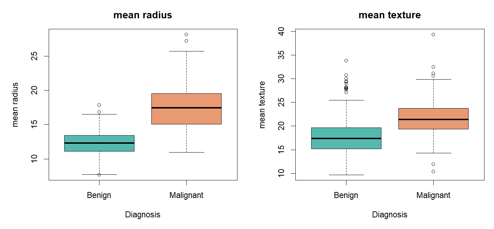
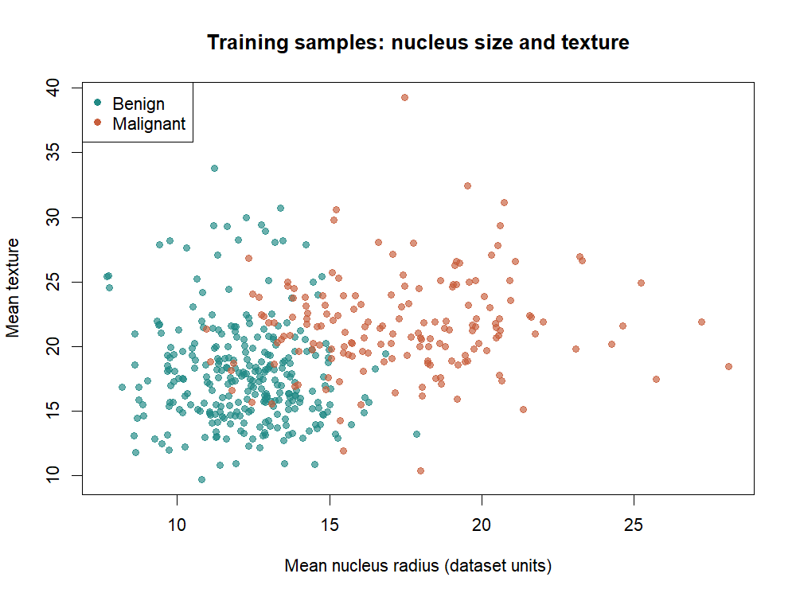
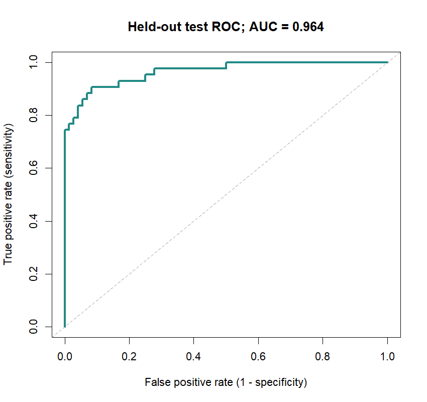

# Distinguishing Benign and Malignant Breast Tumours Using Cell Nucleus Measurements in R

Student registration number: 2021/ASP/53 and GitHub username: 2021ASP53
Worked learning project for ICA3 Bioinformatics 2026.

## Abstract

This project investigates whether two cell nucleus measurements can help distinguish benign from malignant breast masses. The Wisconsin Diagnostic Breast Cancer dataset contains 569 samples and 30 numerical image features. Mean radius and mean texture were chosen in advance to keep the analysis interpretable. After quality checks, a stratified training/test split was used. Training samples supported exploratory plots, Welch comparisons and logistic regression. The separate test set contained 115 samples. At a probability threshold of 0.5, test accuracy was 91.3%, sensitivity was 86.0%, specificity was 94.4% and area under the ROC curve was 0.964. These findings describe performance within one historical dataset. They do not establish clinical usefulness or performance in a new hospital population.

## Introduction

A breast mass may be benign or malignant. The biological question in this project concerns the appearance of cell nuclei measured from digitised fine-needle aspirate images. Numerical image features offer a way to study how recorded morphology differs between the two diagnostic groups. Analysing these measurements is a manageable biomedical data problem because the observations are tabular, the outcome has two categories, and the dataset is small enough to inspect directly. The task requires no sequencing pipeline or specialist laboratory equipment.

The research question is: can mean nucleus radius and mean texture distinguish samples labelled benign from those labelled malignant in this dataset? Radius represents a size-related measurement. Texture is a feature based on variation in image grey-scale values. The predictors were chosen for their straightforward interpretation before model evaluation. This is an educational analysis of an existing benchmark, rather than an attempt to discover a new diagnostic biomarker.

There are two related objectives. First, describe the distributions of the selected measurements within the training data. Second, evaluate whether a logistic regression model using those measurements can discriminate diagnoses in held-out samples. The statistical comparisons ask whether group means differ. The prediction analysis asks whether a fitted relationship is useful for individual sample classification. These are different questions: evidence of a group difference does not guarantee accurate classification for every sample.

## Data and provenance

The original source is the UCI Machine Learning Repository Wisconsin Diagnostic Breast Cancer dataset, attributed to Wolberg, Street and Mangasarian. UCI lists 569 observations and 30 numerical predictors and distributes the data under CC BY 4.0. The variables describe cell nuclei in digitised images of fine-needle aspirates. The diagnosis label records benign or malignant status. The raw collection and image-processing procedures were performed by the dataset creators, not by the author of this worked project.

The bundled CSV was exported from the unmodified data and target arrays in scikit-learn's packaged copy of this dataset. Python was used only to package this existing public data into CSV in an environment without direct UCI downloads. All quality checks, statistical calculations, model fitting and figure creation in the project are implemented in R. This distinction should be retained in the submitted provenance statement. The original UCI identifier column is not present in this redistributed copy. Source row numbers therefore identify observations only within the supplied CSV.

The file contains one diagnosis column and 30 predictors. The analysis uses mean_radius and mean_texture; the other measurements remain available for inspection but are not used to select a better model after seeing test outcomes. There are 357 benign and 212 malignant samples. No personal identifiers have been added. Public availability supports reuse under the stated licence, but does not remove the responsibility to avoid attempts at re-identification or unsupported claims about patients.

## Methods

Run the analysis from the repository root using Rscript code/analysis.R. It requires base R and standard R packages only. The workflow begins by importing the CSV and checking the expected row and column counts, permitted diagnosis labels, numeric feature types and finite measurements. It checks for missing values and duplicate rows. A failed check stops the workflow so that unexpected input is investigated. The script does not quietly remove records or impute values without reporting the issue. A small quality-control table is saved for inspection.

A fixed random seed of 2026 makes the split reproducible within the recorded R environment. Approximately 80% of each diagnostic group is allocated to training, with the remaining samples reserved for testing. This produces 454 training samples and 115 test samples. The split is stratified to preserve representation of both diagnoses. The row allocation is saved in results/split.csv. Exploratory analysis uses training samples, reducing the risk of adjusting modelling decisions to patterns seen in the test set.

Training summaries report group sample sizes, means and standard deviations for the two predictors. Boxplots show the distributions and their overlap, while a scatterplot displays the relationship between radius and texture. These figures support interpretation of the data rather than acting as evidence that either feature determines diagnosis. Observations in overlapping regions may be difficult to classify from these features alone. The images represent recorded samples and cannot establish a causal biological mechanism.

Welch two-sample t-tests compare the diagnostic groups for each predictor in the training data. Welch's method allows unequal group variances. Each comparison estimates the benign-minus-malignant mean difference and a 95% confidence interval. Holm adjustment accounts for the two comparisons. These tests are descriptive and assume independent observations. Skewness or unusual values may affect their interpretation. The estimates and uncertainty should be considered alongside the plots, rather than treating a small p-value as proof of practical importance.

Logistic regression models the probability of malignancy using mean radius and mean texture. It is appropriate for a binary outcome and is simpler to explain than a large collection of competing algorithms. Neither the diagnosis label nor the unused features enter the predictor matrix. No scaling or imputation is needed for this specification. The analysis does not tune predictors, the split or the decision threshold using held-out performance. Predicted probabilities at or above 0.5 are classified as malignant.

Evaluation uses accuracy, sensitivity, specificity, a confusion matrix and ROC area under the curve. Malignant is the positive class. Sensitivity measures the proportion of malignant test samples classified as malignant. Specificity measures the proportion of benign test samples classified as benign. AUC summarises ranking across thresholds, while the confusion matrix describes decisions at the chosen threshold. An exact binomial confidence interval describes uncertainty in test accuracy. A training-majority classifier supplies a simple reference accuracy. These metrics answer complementary questions and should be read together.

## Results

The quality checks and sample allocation are recorded in results/quality_control.csv and results/split.csv. Group summaries and comparison estimates are provided in results/training_summary.csv and results/welch_tests.csv. The training summaries and group comparisons below are populated from the R output. The mean difference is benign minus malignant, so a negative value indicates a larger mean in malignant samples. Interpret effect sizes, confidence intervals and distribution overlap alongside adjusted p-values.

| diagnosis | n | radius_mean | radius_sd | texture_mean | texture_sd |
| --- | --- | --- | --- | --- | --- |
| Benign | 285 | 12.20 | 1.784 | 17.88 | 4.025 |
| Malignant | 169 | 17.37 | 3.187 | 21.58 | 3.736 |

| feature | benign_minus_malignant | ci_lower | ci_upper | p_value | p_holm |
| --- | --- | --- | --- | --- | --- |
| mean_radius | -5.17 | -5.696 | -4.644 | 2.496e-50 | 4.993e-50 |
| mean_texture | -3.70 | -4.434 | -2.966 | 1.051e-20 | 1.051e-20 |

Figure 1. Training-set distributions of mean nucleus radius and mean texture by recorded diagnosis. Boxes summarise the central distribution, and points beyond the whiskers identify values requiring contextual interpretation rather than automatic deletion.

Figure 2. Mean radius plotted against mean texture in the training set. Colours identify diagnosis groups. Shared regions indicate that these measurements need not perfectly separate every observation.

On the held-out test set, accuracy was 91.3%, with an exact 95% confidence interval of 84.6% to 95.8%. Sensitivity was 86.0% and specificity was 94.4%. There were 37 true positives, 68 true negatives, 4 false positives and 6 false negatives. The majority-class reference achieved 62.6% accuracy. These counts and metrics refer only to the saved split; they should not be described as population-wide diagnostic performance.

Figure 3. ROC curve for held-out test predictions. The AUC was 0.964. The diagonal indicates chance-level ranking. AUC concerns ranking and does not by itself show whether estimated probabilities are well calibrated.

## Discussion

Interpret the completed results as evidence about associations and prediction within this dataset. If the model outperforms the majority reference, that indicates information in the selected features beyond simply predicting the common diagnosis. Examine both types of classification error. A high overall accuracy can coexist with missed malignant samples, particularly when the diagnostic groups have different frequencies. The reported sensitivity and false-negative count help make that limitation visible.

Several constraints limit the conclusions. This is one historical benchmark, and its sampling process may differ from current clinical populations. Image acquisition, processing and case selection may change across institutions. The data are already numerical summaries, so this project cannot assess raw-image quality, operator variability or how a new image-processing pipeline would perform. No external hospital dataset is available here. A random internal split therefore provides a limited test of generalisation.

The model assumes a linear relationship between each predictor and the log-odds of malignancy. Nonlinear patterns and interactions are not investigated. Only two features are used, deliberately trading potential performance for simplicity. The split is also only one random allocation. The accuracy confidence interval does not account for every source of uncertainty, including changes in model training or dataset collection. The fixed threshold may not reflect an appropriate clinical balance between error types.

Possible extensions include repeated cross-validation within the training set, comparison with a carefully specified alternative model, and evaluation of calibration. Any tuning should remain separate from final testing. The strongest extension would be external validation in a suitably documented independent dataset. Claims about clinical implementation would additionally require specialist evaluation and consideration of the complete diagnostic pathway. None of those claims follows from a successful classroom classification exercise.

## Conclusion and future work

This project supplies a reproducible example of a biomedical question answered with real public data in R. It links data checks, visual exploration, group comparisons and held-out prediction in one workflow. The completed numerical results determine how well the two measurements distinguish diagnoses in this particular split. Future work should focus on validation and uncertainty before expanding the number of algorithms. The practical learning outcome is understanding how biological measurements become analysable evidence, and where that evidence stops.

## Reproducibility

Use R 4.x with the standard stats, graphics, grDevices and utils packages. Open the project folder and run Rscript code/analysis.R. The script regenerates this README, the HTML report, three figures and the results tables. Exact installed versions and platform information are saved in results/session_info.txt. The CSV is bundled, so the main analysis does not require a network connection. The GitHub workflow repeats the same command in a fresh R environment. Read START_HERE.md for RStudio and GitHub instructions.

## References

Wolberg, W., Street, W., and Mangasarian, O. Breast Cancer Wisconsin (Diagnostic) [Dataset]. UCI Machine Learning Repository. DOI: https://doi.org/10.24432/C5DW2B. Dataset page: https://archive.ics.uci.edu/dataset/17/breast-cancer-wisconsin-diagnostic. Data licence: https://creativecommons.org/licenses/by/4.0/.

Scikit-learn developers. load_breast_cancer dataset documentation. https://scikit-learn.org/stable/modules/generated/sklearn.datasets.load_breast_cancer.html. Used as the distribution source of the bundled measurements and labels.

R Core Team. R: A Language and Environment for Statistical Computing. R Foundation for Statistical Computing, Vienna. https://www.r-project.org/. Record the version actually used in results/session_info.txt.
